# Design review

Captured from the running app in Chromium. Business and carrier navigation now comes from administrator-assigned membership; there is no public role selector. Rates, dates, carrier profiles, bookings, and payouts are illustrative.

## Desktop sign-in

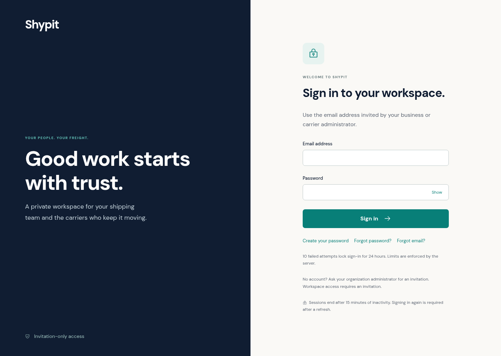

## Mobile sign-in

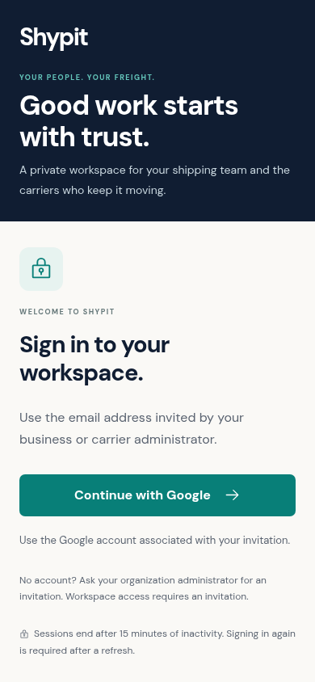

These show the email/password preview entrance and the chooser for explicitly approved company and carrier memberships. Real login remains blocked until the two Auth accounts and database memberships are provisioned. Workspace screenshots below use intercepted test responses and sample data; they are not proof of a connected live account.

## Account setup and email recovery

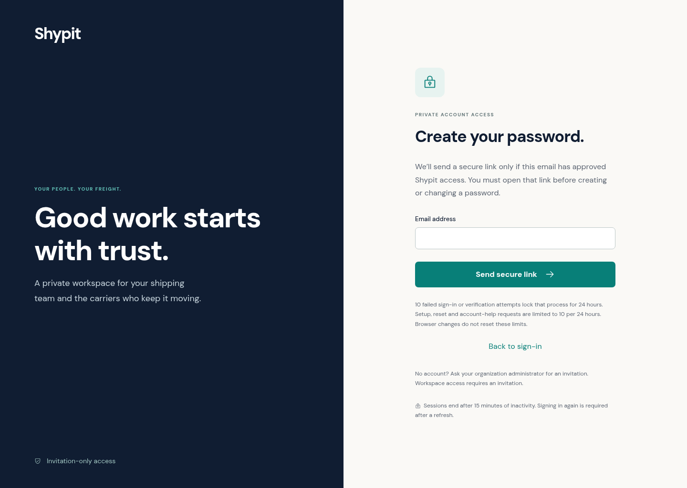

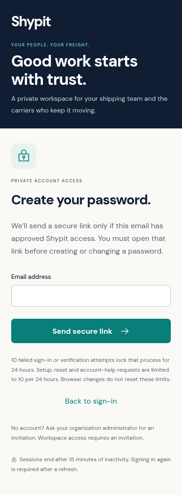

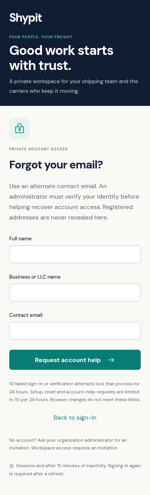

These screens are implemented. Real delivery and backend lock enforcement require the activation steps in [the account-recovery guide](../account-recovery.md).

## Approved workspace chooser

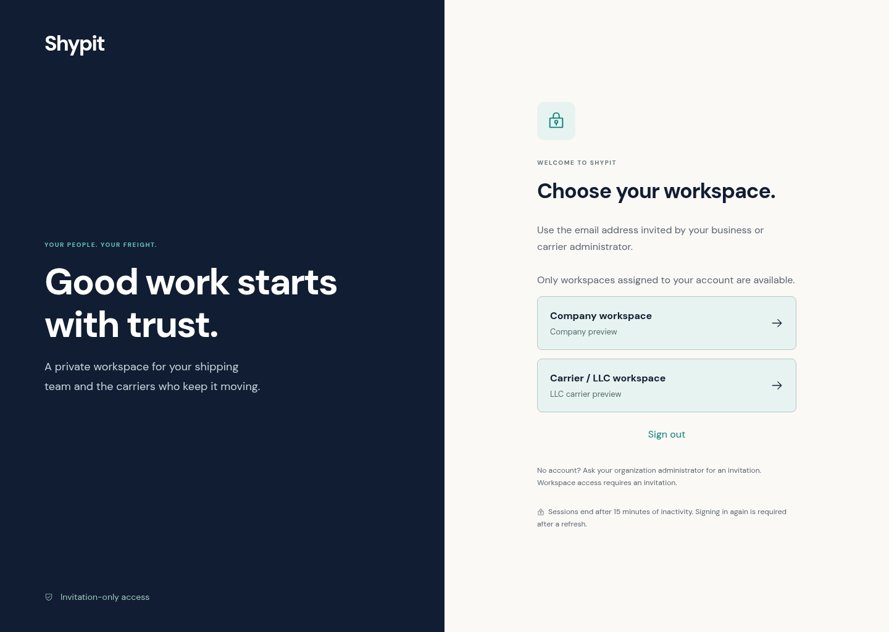

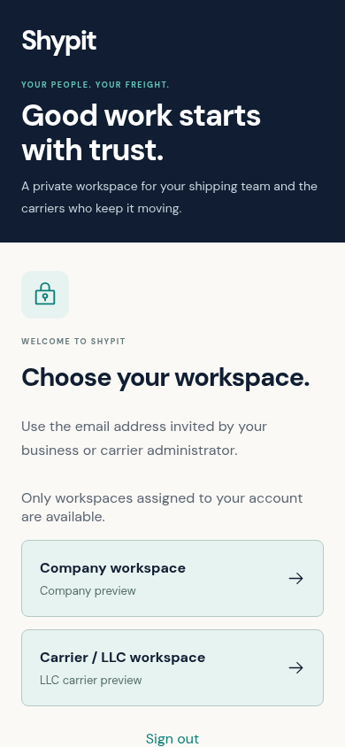

## Desktop business workspace

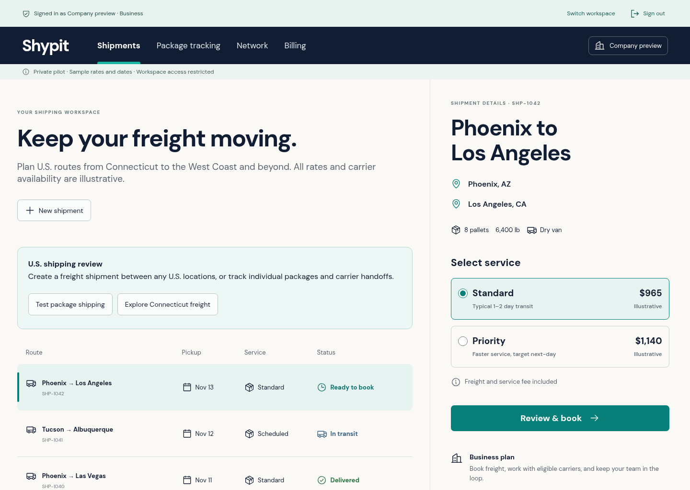

## Desktop driver workspace

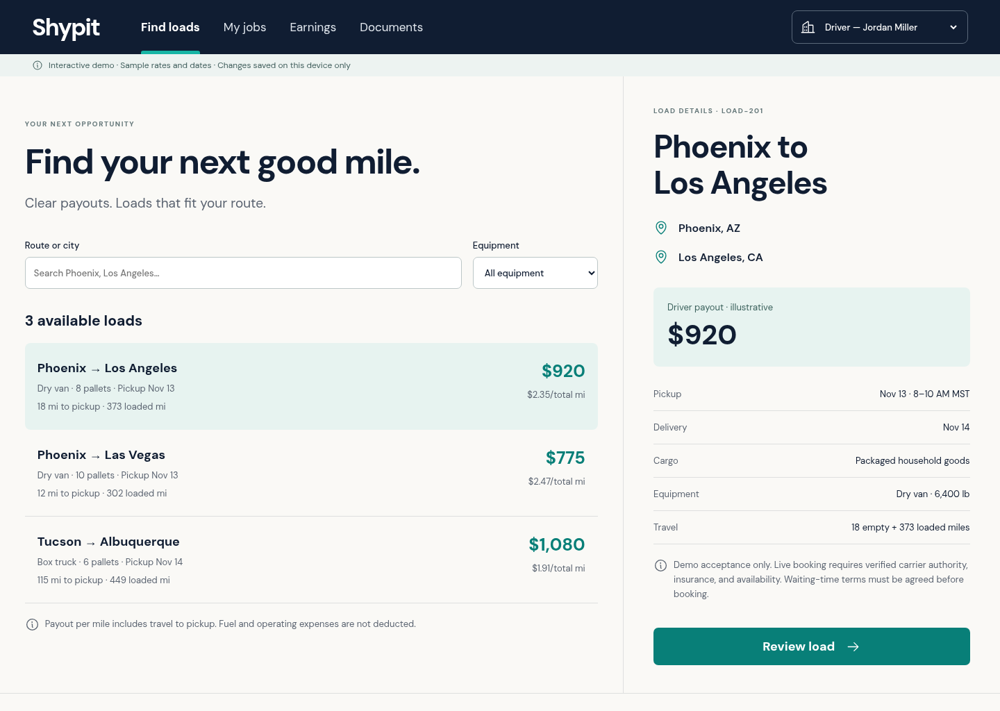

## Mobile business workspace

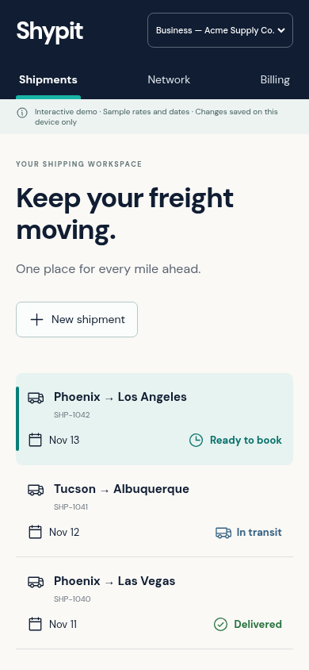

## Mobile driver workspace

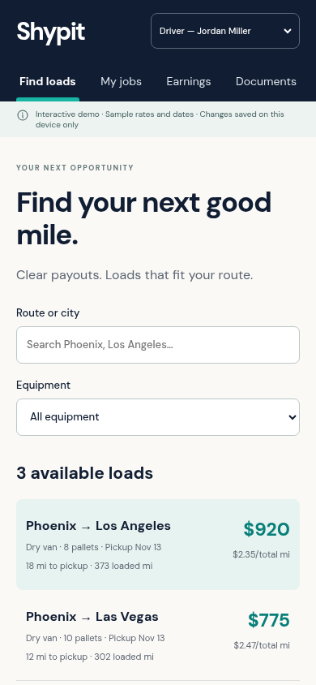

For an interactive preview, follow the GitHub Pages instructions in the root README. Screenshots are review assets, not a live deployment.
